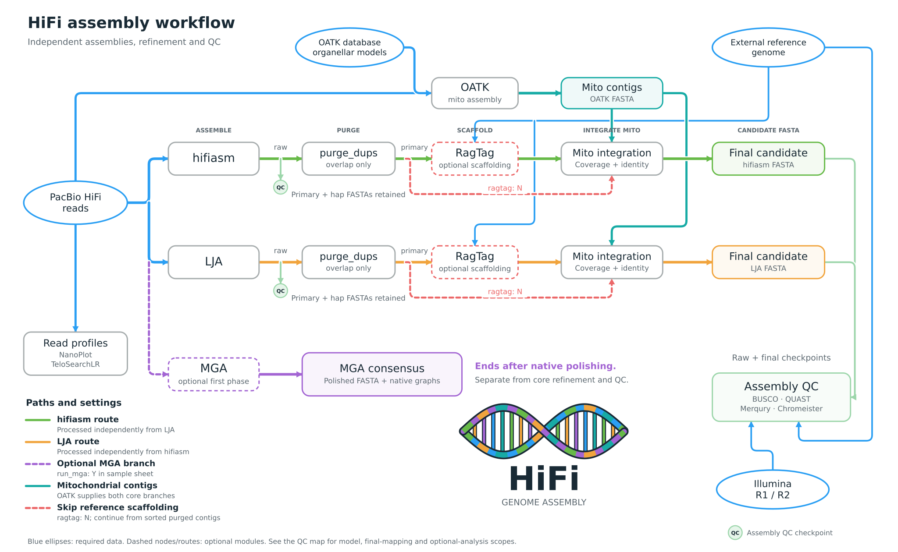
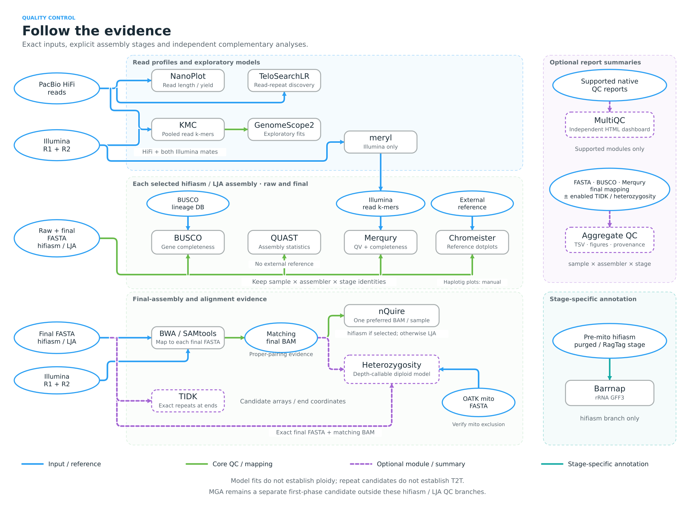

# snakemake_HiFi_assembly

Snakemake workflow for **de novo genome assembly from PacBio HiFi reads**, including
assembly, duplicate purging, reference-guided scaffolding, and extensive quality control.

The workflow supports Linux HPC execution with per-rule Conda environments and
recorded input/tool provenance. Select assemblers and optional analyses for each
project while keeping raw, purged and final assembly stages separate.



---

##  Overview

The workflow performs the following steps per sample:

1. **HiFi assembly**
   - hifiasm and/or LJA, selected per sample; at least one is required
   - MGA (optional first-phase candidate; disabled by default)

2. **Mitochondrial assembly**
   - OATK assembles mitochondrial candidates from HiFi reads in parallel
   - Conservative integration follows core assembly post-processing

3. **Duplicate purging**
   - Overlap-only purge_dups for hifiasm/LJA, retaining primary and haplotig outputs

4. **Reference-guided scaffolding (optional)**
   - RagTag
   - Reference-order sorting for references with at most 32 sequences; length
     sorting for larger reference collections

5. **Annotation & analysis**
   - Barrnap (rRNA on the processed hifiasm assembly, before mitochondrial integration)
   - TeloSearchLR (repeat screening in HiFi reads)
   - Chromeister (assembly–reference comparison)

6. **Quality control**
   - NanoPlot (HiFi read QC)
   - GenomeScope2 (pooled HiFi/Illumina k-mer profiles and exploratory model fits)
   - nQuire (fixed-model comparison using one preferred final BAM per sample)
   - BUSCO
   - QUAST
   - Merqury
   - Mapping QC
   - MultiQC summary (optional; set `run_multiqc: true`)
   - Final-assembly TIDK screening (optional)
   - Callable-site diploid-model heterozygosity (optional)
   - Aggregate QC table and figures (optional)

The pipeline supports **conditional execution of RagTag** based on a sample sheet flag.
Assembler selections apply to downstream QC as well as assembly targets.

---

## Workflow figures

The overview shows the two independent core branches, the RagTag bypass, and
parallel OATK mitochondrial assembly. MGA ends at its own first-phase candidate;
it does not enter the hifiasm/LJA final-processing or QC branches.

Blue ellipses identify required data; colored routes distinguish assembly paths,
organellar inputs and optional branches. Mint QC taps mark raw/final evaluation
checkpoints. The genomic ribbon motif is an original vector drawing.

The QC map shows the actual inputs and assembly stages evaluated by each tool.
GenomeScope2 currently pools HiFi and both Illumina mates; Merqury uses
Illumina-derived read k-mers. Optional aggregate QC and MultiQC are separate
reporting routes.



| Figure | Editable vector | Print / slides | High-resolution image |
| --- | --- | --- | --- |
| Assembly overview | [SVG](docs/figures/workflow_overview.svg) | [PDF](docs/figures/workflow_overview.pdf) | [PNG](docs/figures/workflow_overview.png) |
| QC evidence map | [SVG](docs/figures/quality_control.svg) | [PDF](docs/figures/quality_control.pdf) | [PNG](docs/figures/quality_control.png) |

Regenerate all exports with the included [drawing script](docs/figures/render_workflows.py):

```bash
python docs/figures/render_workflows.py
```

PDF/PNG export requires `rsvg-convert` from librsvg. Use `--svg-only` to generate
the editable SVGs using Python's standard library. PNGs are exported at 3200 px
width. These figures summarize the implemented workflow; sample flags determine
the jobs scheduled for a particular run.

The drawing source is split into
[assembly layout](docs/figures/assembly_diagram.py),
[QC layout](docs/figures/qc_diagram.py), and
[shared vector styling](docs/figures/diagram_style.py).

---

##  Requirements

### Core requirements

- Linux x86_64
- Conda with the libmamba solver
- Python 3.12, Snakemake 9.5.1, and pandas (provided by `environment.yaml`)
- Chrome or Chromium for NanoPlot/TeloSearchLR image export through Kaleido
- Network access for Conda/pip packages and pinned Git sources
- An appropriate OATK mitochondrial HMM database; BUSCO datasets can be
  downloaded automatically or supplied through a populated offline cache

Create the tested workflow runtime before configuring a project:

```bash
conda env create --file environment.yaml
conda activate hifi-assembly
export PYTHONNOUSERSITE=1
export CONDA_CHANNEL_PRIORITY=strict
```

Per-rule Conda environments provide the bioinformatics executables. GenomeScope2,
nQuire and MGA also have project-local source installation steps. The OATK database
and browser are external prerequisites. Kaleido 1.x must be able to find a
working Chrome/Chromium installation; a headless server may also need its browser's
system libraries. Check this before starting a long analysis. If you install a
browser with `kaleido_get_chrome`, run it from the relevant plotting Conda
environment. `BROWSER_PATH` can select an existing executable. Keep Python user
packages isolated from the runtime and tool environments; the workflow also
sets `PYTHONNOUSERSITE=1` for its tool jobs.

GenomeScope2's required R packages are provided by Conda. Its pinned source is
installed directly into a project-specific R library, without downloading
optional CRAN dependencies.

---

##  Repository Structure

```
snakemake_HiFi_assembly/
├── environment.yaml        # Snakemake/Python runtime
├── config/
│   ├── config.yaml
│   └── samples.tsv
├── workflow/
│   ├── Snakefile
│   ├── accessors.smk
│   ├── rules/
│   ├── envs/
│   └── scripts/
├── docs/figures/            # SVG, PDF, PNG and drawing source
├── tests/
└── README.md
```

---

##  Configuration

### `config/config.yaml`

The [configuration](config/config.yaml) and [sample table](config/samples.tsv)
are generic GitHub templates. Create ignored local copies before editing them:

```bash
cp -n config/config.yaml config/config.local.yaml
cp -n config/samples.tsv config/samples.local.tsv
```

Existing local copies are kept. Replace every placeholder path in your copies
with an absolute path, and replace or remove all example sample rows. Set the
local YAML's `sample_sheet` to the absolute path of your local TSV. The templates
include the current optional modules, defaults, and validated source revisions.

```yaml
project_dir: "/absolute/path/to/hifi_project"
sample_sheet: "/absolute/path/to/repository/config/samples.local.tsv"
oatk_db: "/absolute/path/to/OatkDB/your_lineage_mito.fam"
run_mga: false
run_multiqc: false
run_tidk: false
run_heterozygosity: false
run_qc_summary: false
purge_dups_mode: "overlap_only"
```

The tab-separated sample table requires `sample`, `HiFi`, `fq1`, `fq2`, and `Ref`.
Use absolute file paths and unique sample IDs. Optional `run_hifiasm` and
`run_lja` columns select assemblers; both default to enabled when their columns
are absent. Every sample must enable at least one assembler. The optional
`ragtag` column defaults to disabled. Flags accept `Y`/`N` or `true`/`false`.
`Ref` is required for Chromeister even when RagTag is disabled. The example rows
demonstrate both core assemblers, hifiasm only, and LJA only.

The complete workflow expects HiFi and paired Illumina reads in standard
four-line FASTQ format, optionally gzip-compressed. `Ref` is nucleotide FASTA.
The standalone MGA helper also accepts FASTA reads; this does not change the
input requirement of the other workflow stages.

The sample table includes `run_mga`, initially `N` for every row. Set it to `Y`
for selected samples to add MGA. This column takes priority over the YAML
`run_mga` setting; omit the column to use the global default instead.

`project_dir` is created and becomes the working directory during parsing,
including dry-runs. Use a separate project directory to test changes. The
sample-sheet path and every input path must therefore be absolute. Use
`--cores` and `--set-threads rule=N` for CPU allocation. The
`--resources mem_mb=...` option sets a scheduling budget against declared job
requirements; tool-specific memory settings still apply. GenomeScope2 currently
requests 64,000 MB, and MGA defaults to 64,000 MB.

Use shell-safe paths without whitespace or shell metacharacters. Several upstream
tools construct shell commands internally; MGA additionally validates its path
characters explicitly.

Purging currently uses self-alignment overlaps without read-depth
classification. The former `purge_dups_low`, `purge_dups_mid`, and
`purge_dups_high` settings are rejected because they cannot affect this mode.
Retain and inspect the haplotig outputs before selecting a purged candidate:
overlap-only purging can substantially reduce sequence and k-mer completeness,
and the biological identity of removed sequence requires review.
Mitochondrial replacement combines split alignments and requires both 80% query
coverage and 95% assembly-record coverage at 95% identity. These thresholds can
be configured with `mito_min_query_coverage`, `mito_min_target_coverage`, and
`mito_min_identity`; nuclear scaffolds containing mitochondrial fragments are
retained.

BUSCO optionally accepts `busco_download_path`, `busco_offline: true`, and
`busco_lineage`. Use a run-specific cache when running analyses concurrently;
offline mode requires the relevant datasets and placement files to exist.

---

##  Running the Workflow

Run commands from the repository root. Check the configured DAG first:

```bash
snakemake --snakefile workflow/Snakefile --configfile config/config.local.yaml \
  --use-conda --cores 32 --resources mem_mb=128000 --dry-run
```

Then execute the workflow:

```bash
snakemake --snakefile workflow/Snakefile --configfile config/config.local.yaml \
  --use-conda --cores 32 --resources mem_mb=128000 \
  --printshellcmds --latency-wait 30 --keep-going --rerun-incomplete
```

Use an isolated project directory for tests. Focused regressions can be run from
an environment containing Snakemake:

```bash
python -m unittest discover -s tests -v
```

Merqury evaluates each selected assembler independently. Reports are now under
`Assemblies/<sample>/QC/merqury/{raw,final}/{hifiasm,lja}/`, with explicit input
and tool hashes in `inputs.json`. The runner uses the Merqury installation
selected by the rule's environment, including its supporting scripts. Native
prefixed completeness reports are retained alongside the stable
`completeness.stats` filename. The raw/final aggregate completion markers remain.
Rerun Merqury before aggregating legacy reports without assembly hashes; updating
the workflow does not repair historical results.

The environment pairs Merqury 1.4.1 with meryl 1.4.1. A per-job plotting adapter
omits zero-height assembly-only bars to handle single-copy spectra correctly.
It checks the pinned plotting source and records original/adapted hashes; native
histograms and numerical metrics remain available for independent inspection.

GenomeScope summaries report actual fit percentages and an explicitly
exploratory `best_by_model_fit` ranking. This ranking is not a validated
biological ploidy assignment. Chromeister declares the actual
`.mat.filt.png` images and checks that they are valid PNGs. Barrnap writes GFF3
separately from diagnostic logs.

The obsolete `filter_hifiasm` and `filter_lja` targets have been retired.
Use the standard final-assembly targets for mitochondrial integration; those
rules apply the configured coverage/identity thresholds and preserve nuclear
flanks when an assembly record contains only a mitochondrial fragment.
RagTag reordering checks that every scaffold ID and length is retained and stops
on an extraction failure. Copied haplotig FASTAs retain their original IDs, with
an identity mapping in the accompanying name map.

nQuire uses the final hifiasm BAM when hifiasm is enabled, otherwise the final LJA
BAM: one comparison per sample. It validates native site counts before fitting
fixed models 2/3/4 and writes
an explicit status/provenance JSON beside the native results. Zero informative
sites produce `NA`, and exact model ties remain ambiguous; neither is reported
as diploidy. Its selected fixed model is exploratory evidence, not confirmed
biological ploidy.

MultiQC can also be requested explicitly with the `multiqc` target. It
summarizes supported native reports; individual Merqury reports remain the
source for assembler-specific QV and completeness.

### Main outputs

Paths below are relative to `project_dir`; `<assembler>` is `hifiasm` or `lja`.

| Stage or report | Path |
| --- | --- |
| Raw hifiasm assembly | `Assemblies/<sample>/HIFIASM/<sample>.fasta` |
| Raw LJA assembly | `Assemblies/<sample>/LJA/assembly.fasta` |
| Purged hifiasm primary / haplotigs | `Assemblies/<sample>/PURGE_DUPS/{purged,hap}.hifiasm.fa` |
| Purged LJA primary / haplotigs | `Assemblies/<sample>/PURGE_DUPS_LJA/{purged,hap}.lja.fa` |
| Mitochondria-integrated candidate final | `<sample>_FINAL_ASSEMBLIES/<assembler>/<sample>.purged.final.fasta` |
| MGA first-phase candidate | `Assemblies/<sample>/MGA/assembly.fasta` |
| Native QC reports | `Assemblies/<sample>/QC/` |
| Optional aggregate QC | `Assemblies/qc_summary/assembly_qc.tsv` and `.pdf`, `.svg`, `.png` figures |
| Optional MultiQC | `Assemblies/multiqc/multiqc_report.html` |

The candidate final includes RagTag scaffolding only for samples that enable it.
Keep the separate primary and haplotig FASTAs when reviewing purge losses.
The filename `final` identifies a workflow stage; choosing a biologically
appropriate assembly still requires review.

### Manual haplotig comparisons

The default `all` target runs Chromeister on raw and final core assemblies.
Two additional haplotig dotplot targets are available for RagTag-enabled
samples. For a sample with both assemblers and `ragtag=Y` in its TSV row:

```bash
hifi_project="/absolute/path/to/hifi_project"
hifi_sample="SAMPLE_ID"
snakemake --snakefile workflow/Snakefile --configfile config/config.local.yaml \
  --use-conda --cores 2 \
  "$hifi_project/Assemblies/$hifi_sample/RAGTAG/FINAL_$hifi_sample/CHROMEISTER/.final_hap_hifiasm.done" \
  "$hifi_project/Assemblies/$hifi_sample/RAGTAG_LJA/FINAL_$hifi_sample/CHROMEISTER/.final_hap_lja.done"
```

Set the variables to your configured project and sample. Request only the
matching target when one assembler is enabled. These plots compare retained
haplotigs with the reference; they do not establish haplotype completeness.

### Optional MGA first phase

[Mosaic Genome Assembler](https://github.com/ZhangZhenmiao/MGA) produces
haplotype-mixed consensus assemblies from HiFi reads using its bundled LJA.
Enable selected samples with a `run_mga` column, or all samples with
`run_mga: true` in the configuration. MGA is disabled by default. It is an
additional first-phase candidate; the existing final-assembly/QC branches still
require hifiasm or LJA. It does not consume this workflow's standalone LJA output.

The source build is pinned to commit
`f0f26da124e5e1362875dbf15c0de1bec2fd34f8`. `mga_commit` may select another full
40-character commit SHA. The rule installs a revision-specific source tree under
`resources/mga/`, preserving the relative paths required by MGA and its bundled
tools. The Conda environment provides C++20 build tools and runtime dependencies.
Default requests are 32 threads and 64 GB memory (`mga_mem_mb` configures memory).
The runner limits native MGA descendants to the allocated Linux CPU affinity
mask, including stages that launch threaded tools concurrently.

The runner validates and privately rewrites FASTA/FASTQ read headers to remove
whitespace metadata while preserving sequence and quality. It retains native
graphs/stages and `5_polishing/assembly.fasta` under `Assemblies/<sample>/MGA/`,
publishes a checked `assembly.fasta`, and records `mga_run.json` before `mga.done`.
Failures retain native diagnostics in a separate failed-run directory.

MGA already performs deduplication; its output is not automatically routed
through purge_dups or the hifiasm/LJA final-processing rules. Extending downstream
QC to MGA requires an explicit assembler-aware branch and validation. The paper's
diploid haplotype-mixed objective should not be treated as validation for every
ploidy represented in a cohort.

---

## Optional final-assembly QC

The following independent modules are disabled by default. Enable any combination
in the configuration. TIDK and heterozygosity evaluate every selected hifiasm/LJA
final assembly; aggregate QC combines raw and final evidence:

```yaml
run_tidk: true
run_heterozygosity: true
run_qc_summary: true
```

**TIDK** adds final-assembly end screening alongside the read-based TeloSearch
analysis. Outputs under `Assemblies/<sample>/QC/tidk/<assembler>/` include
candidate motifs, exact-repeat arrays, per-sequence/end counts, source/tool hashes,
and explicit screening status. TIDK 0.2.7 is pinned. Defaults discover periods
5–30, examine the terminal 5% for discovery, retain the top ten primitive motifs,
and independently validate at least five exact tandem copies within adaptive
terminal windows up to 10 kb. Config keys are `tidk_minimum`, `tidk_maximum`,
`tidk_threshold`, `tidk_distance`, `tidk_top_n`, `tidk_copies`, `tidk_end_size`,
`tidk_window`, and `tidk_min_sequence_length`. All sequences are included by
default; organellar-name hints do not exclude sequences. Exact-repeat candidates
do not establish T2T status or chromosome counts, and exact-repeat absence is weak
evidence for heterogeneous telomeres.

**Heterozygosity** reuses each final assembly's Illumina BAM and explicitly models
diploid genotypes with BCFtools 1.22/SAMtools 1.22.1. It reports unique originally
biallelic heterozygous SNPs divided by depth-callable nuclear ACGT positions.
Mapping/base quality thresholds are 30/20, SNP QUAL is at least 30, each allele
needs at least three reads, and depth must be at least 10 and at most
`max(10, round(2 * positive_mean_depth))`. The denominator and SNP depth filters
use the same all-site caller depth; missing-GT/GQ filters are not imposed on the
denominator. This is a conditional, depth-callable diploid-model estimate, not
confirmed biological heterozygosity or cellular ploidy.

Known appended OATK mitochondrial records are identified and sequence-verified
before exclusion. Other organellar/contaminant sequences are not inferred from
broad name patterns. Additional exact exclusions must be assembler-specific:

```yaml
heterozygosity_min_callable_fraction: 0.5  # review flag; estimates remain explicit
heterozygosity_exclude_contigs:
  SAMPLE_ID:
    hifiasm: [SAMPLE_ID_scaff17]
    lja: [SAMPLE_ID_scaff23]
```

Outputs under `QC/heterozygosity/<assembler>/` include callable/nuclear BEDs,
heterozygous VCF/TSV, allele balance, depth diagnostics, summary JSON/TSV, and a
receipt with source/output hashes and reference-consistency limits. Low
callability is flagged. Zero-callable or zero-nuclear cases have a null estimate,
not an imputed zero. Private reference indexes and temporary BCFs leave source
assemblies and BAMs unchanged; failure diagnostics are retained.

**The aggregate table and figure** are written to `Assemblies/qc_summary/` as
`assembly_qc.tsv`, a provenance JSON, and PDF/SVG/PNG plots. Rows are keyed by
sample, assembler, and raw/final stage. FASTA statistics are calculated directly,
selected BUSCO summaries retain lineage/marker context, Merqury provenance and
labels are checked, and proper pairing uses paired-in-sequencing reads as its
denominator. Enabled optional metrics are joined only after receipt/reference
identity checks. Missing, unrequested, untestable, and infinite metrics remain
explicit. The plot is descriptive and does not assign a combined quality score.
Multiple assemblies of one strain are not biological replicates.

These modules adapt the reviewed EPIC QC methods into independent rules; they do
not invoke its cohort supervisors or modify its scripts/data. They currently
evaluate hifiasm/LJA final branches; MGA remains a separate first-phase candidate.

PloidyFrost, Smudgeplot, depth-based ploidy plotting, and the separate RagTag
Chromeister module remain experimental development files. They are not included
in the released workflow and are outside its execution/dependency validation.

##  Software Used

Snakemake, hifiasm, LJA, OATK, purge_dups, RagTag, NanoPlot, GenomeScope2, nQuire,
BUSCO, QUAST, Merqury/meryl, KMC, TeloSearchLR, Barrnap, Chromeister, BWA,
minimap2, MultiQC, optional MGA, TIDK, BCFtools, and SAMtools.

## Validation

The release candidate was checked on Linux x86_64 on **18 November 2026**:

- 84 regression tests passed with native fixtures available and no skipped tests.
- One complete original-read run exercised both core assemblers, RagTag, a fresh
  MGA first-phase build, and all optional QC/reporting modules: 45 default jobs
  and two separately requested haplotig comparisons completed.
- All 58 independent core-output checks passed, alongside read-flow,
  sequence-conservation and MGA stage/graph checks.

Job counts describe that test configuration; sample and module selections change
the DAG. Tests requiring unavailable native executables report skips. Private
inputs, test results and audit inventories are kept outside the public release.
These checks validate execution and content consistency, not biological assembly
quality. Purging, reference-guided joins and exploratory model results require
review for each sample.

Conda/pip recipes are not complete platform lockfiles, and native threaded stages
can produce small differences between runs. Retain resolved software versions,
input hashes, parameters and output provenance with each analysis.

---

##  Contact

Verstrepen Lab — KU Leuven  
https://verstrepenlab.sites.vib.be/en  
Contact: **michael.abrouk@kuleuven.be**
